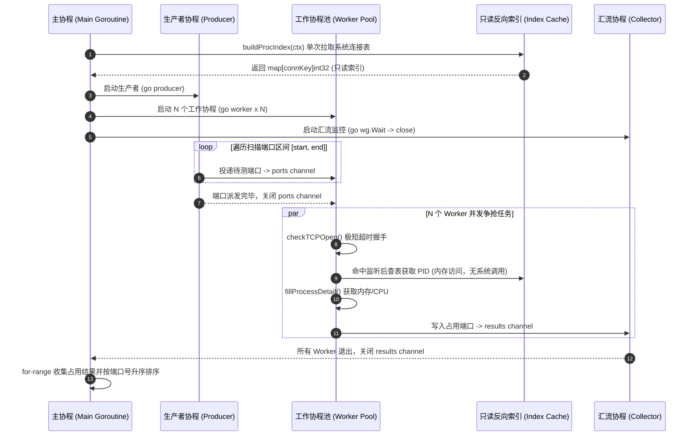

# port-detective (本地端口侦探与进程体检工具)

> 🚀 **AI-Native 跨平台本地端口体检与安全释放引擎**  
> 专为 **Claude Code / Cursor / Windsurf / AI IDE** 及开发者终端设计，原生支持 **MCP (Model Context Protocol)** 协议与高并发并发协程池。

---

## 📖 1. 项目背景与解决痛点

在现代全栈开发与微服务调试过程中，端口冲突是高频发生的问题（例如：`Error: listen EADDRINUSE: address already in use :::3000` 或 `bind: address already in use`）。

### 传统排查方式的局限与痛点：
1. **平台命令碎片化**：Windows 依赖 `netstat -ano | findstr` 再配合 `taskkill`；Linux/macOS 则依赖 `lsof -i`、`ss -tulpn` 或 `fuser`。命令参数晦涩，跨平台体验极不一致。
2. **信息单薄，缺乏体检上下文**：传统命令往往只能输出 PID，无法直观查看进程的 **物理内存 (RSS) 占用、CPU 开销、启动命令行与二进制路径**，难以判定该进程是开发遗留的僵尸进程（如孤儿 node/python），还是重要的系统守护进程。
3. **AI 编程智能体 (Agent) 无法可靠交互**：像 Claude Code、Cursor 等 AI 编程助手若通过执行终端 Shell 脚本排查端口，不同平台命令极易因权限、输出解析正则错误而翻车，甚至可能误杀系统关键进程。

### `port-detective` 解决方案：
- **双模统一架构**：同一套底层并发探测引擎，同时驱动 **现代终端 CLI** 与 **AI-Native MCP Stdio 服务端**。
- **深度进程体检**：一次调用即可全景获取：端口占用状态、归属进程名、PID、内存占用（自动换算 B/KB/MB/GB）、CPU 百分比、启动参数与可执行文件路径。
- **并发高性能扫描**：基于 Go 原生并发模型（`goroutine` + `channel` + `sync.WaitGroup`），全端口（1-65535）探测秒级完成，常用开发端口毫秒级返回。
- **跨平台鲁棒性与权限优雅降级**：100% 纯 Go 实现，无 CGO 依赖，在 Windows / Linux / macOS 下行为完全一致；针对系统受限进程提供优雅降级（`<no-access>` 标识与友好提示），绝不崩溃。
- **MCP 纯净通道保证**：严格遵守 MCP Stdio 协议规范，`os.Stdout` 保持 100% 纯净 JSON-RPC 报文，所有诊断日志严格分流至 `os.Stderr`。

---

## 🏗️ 2. 系统三层架构设计

`port-detective` 遵循清晰的分层解耦与模块化设计原则，严格杜绝循环依赖与职责泄露：

```mermaid
flowchart TD
    subgraph Layer1["1. 交互与协议接入层 (Interface & Protocol)"]
        CLI["CLI 终端命令 (Cobra)<br/>check / scan / kill / mcp<br/>(CJK 显示宽度对齐 / NO_COLOR / --json)"]
        MCP["MCP Stdio 服务端 (mcp-go)<br/>inspect_port / scan_dev_ports / free_port<br/>(stdout 纯净 JSON-RPC / stderr 诊断日志)"]
    end

    subgraph Layer2["2. 核心并发业务引擎 (Core Engine)"]
        direction TB
        DISPATCH["任务分发管道 (ports chan int)"]
        WORKERS["工作协程池 (N x Worker Goroutines)<br/>并发探测 / sync.WaitGroup 协同编排"]
        COLLECT["结果汇聚管道 (results chan PortInfo)<br/>升序排序 / Context 优雅取消"]
        INDEX["只读反向索引缓存 (connKey -> PID)<br/>单次全量构建系统连接表，所有协程共享"]
    end

    subgraph Layer3["3. 操作系统底层抽象层 (OS & Kernel Abstraction)"]
        NET["标准库 net.DialTimeout<br/>TCP/IPv4 & IPv6 双栈连通性快速探测"]
        GOPSUTIL["gopsutil/v3 (net + process)<br/>跨平台连接表 / PID 反查 / 内存 RSS / CPU% / 命令行"]
        SIGNAL["进程信号与控制 (Terminate / Kill)<br/>跨平台优雅终止与强制释放"]
    end

    CLI -->|调用 InspectPort / ScanPorts / KillPort| Layer2
    MCP -->|调用 InspectPort / ScanPorts / KillPort| Layer2

    DISPATCH --> WORKERS
    WORKERS --> COLLECT
    INDEX -.->|只读共享 (无锁竞争)| WORKERS

    WORKERS --> NET
    WORKERS --> GOPSUTIL
    Layer2 --> SIGNAL
```

### 模块职责与边界边界说明：
- **`internal/core`**：核心能力层。负责底层端口连通性探测、进程指标采集与并发调度。**严禁依赖任何 CLI (Cobra) 或 MCP (mcp-go) 库**，保证纯粹的业务逻辑与可测性。
- **`internal/cli`**：Cobra 终端交互层。负责参数解析、彩色高亮（遵循 `NO_COLOR` 规范）、自研 CJK 双列宽终端表格对齐及 `--json` 机器可读输出。
- **`internal/mcpserver`**：Model Context Protocol 服务端实现。将 core 层能力标准化封装为 AI Tools，提供 Stdio 双向通信。
- **`main.go`**：项目唯一入口，仅负责调用 `cli.Execute()`。

---

## ⚡ 3. Go 语言并发设计亮点与协程池解析

并发扫描是本项目的核心得分点与工程亮点，集中实现在 `internal/core/detector.go` 的 `ScanPortsConcurrent` 函数中。

### 3.1 协程池与通道数据流设计



### 3.2 核心并发技术亮点解析

#### 亮点 1：单次索引构建，彻底消除 $O(N)$ 系统调用风暴
- **背景难题**：在 Windows 平台下，`gopsutil` 的 `ConnectionsPid` 并未实现（直接返回 `ErrNotImplementedError`）；若为每个扫描端口单独发起系统连接表查询，扫描 1000 个端口就会产生 1000 次昂贵的内核态调用。
- **解决方案**：在启动并发扫描前，主协程单次全量拉取系统 `inet` 连接表，在内存中构建以 `connKey{port, sockType}` 为键、`PID` 为值的反向哈希索引。该索引在并发探测期间**作为只读共享结构传递给全部工作协程**。
- **收益**：将系统调用次数从 $O(N)$ 骤降至 $O(1)$，内存访问零锁竞争（无 Mutex 锁开销），使得全端口 65535 扫描在普通 PC 上仅耗时约 8 秒。

#### 亮点 2：标准 Worker Pool 模式与双重 WaitGroup 协同
- 采用 **生产者 - 消费者 - 汇聚者** 经典三阶段流水线：
  - **任务通道** `ports := make(chan int, workers)`：带缓冲通道，平滑派发速率。
  - **结果通道** `results := make(chan PortInfo, workers)`：工作协程发现占用端口后投递至该通道。
  - **汇聚协程**：使用单独的协程等待全部 worker 执行完成（`wg.Wait()`），再安全关闭 `results` 通道，防止主协程在 `for-range` 消费时发生死锁或读取未完成数据。

#### 亮点 3：级联 Context 优雅取消与防泄漏
- 无论是任务派发、端口握手还是结果投递，所有通道收发均配合 `select` 监听 `ctx.Done()`：
  ```go
  select {
  case <-ctx.Done():
      return // 上游取消时迅速收工，释放协程资源
  case ports <- port:
  }
  ```
- 当用户在终端发起 `Ctrl+C` 或上层超时发生时，所有后台 Worker 会立即终止未完成的探测任务，避免无谓的 CPU 与网络套接字占用。

#### 亮点 4：结果排序与幂等确定性
- 并发协程完成任务的顺序是不确定的。`core` 层在收集完所有活跃端口后，强制通过 `sort.Slice` 进行升序重排，确保 CLI 渲染、单测断言和 AI 工具调用的结果具备 100% 的幂等性与确定性。

---

## 🖥️ 4. 终端 CLI 使用指南与真实运行效果

### 4.1 CLI 命令一览

```text
port-detective
├── check <端口>    [-p tcp|udp] [--json]                 体检指定单端口
├── scan            [-p tcp|udp] [-w N] [--range A-B] [-a] [--json]   扫描被占用端口
├── kill  <端口>    [-f|--force] [-y|--yes] [--json]      安全释放占用端口
└── mcp             [--json]                              启动 MCP Stdio 服务端
```

### 4.2 命令运行实测示例

#### ① 单端口详细体检 (`check`)
查询指定端口的监听状态及占用进程全景指标：
```bash
port-detective check 19387
```
**终端真实输出：**
```text
端口体检  TCP/19387
──────────────────────────────────────────────────────────
  连接状态
  状态       : 已占用
  协议       : TCP

  归属进程
  进程名     : DeepSeek Harness.exe
  PID        : 97192
  可执行文件 : F:\deepseek-harness\DeepSeek Harness.exe
  常驻内存   : 240.5 MB
  CPU 占用   : 4.0%
  启动时间   : 2026-10-14 22:13:39

──────────────────────────────────────────────────────────
  探测耗时 6ms  ·  释放命令  port-detective kill 19387
```

检查空闲端口：
```text
端口体检  TCP/8080
──────────────────────────────────────────────────────────
  连接状态
  状态       : 空闲
  协议       : TCP
  结论       : 该端口当前无人监听，可以直接使用。
──────────────────────────────────────────────────────────
  探测耗时 5ms
```

#### ② 端口扫描与表格输出 (`scan`)
- 默认读取系统连接表（毫秒级列出所有正在监听的本地服务端口）：
```bash
port-detective scan
```
**终端真实输出（自研 CJK 字符宽度动态对齐 + 权限优雅降级）：**
```text
端口扫描  TCP
──────────────────────────────────────────────────────────────

 PORT     PID   PROCESS                           RSS    CPU
  135    2680   <no-access>                         -      -
  139       4   System                              -      -
  445       4   System                              -      -
 1042   27544   asus_framework.exe            43.8 MB   0.1%
 4709   74800   wpscloudsvr.exe               19.3 MB   2.1%
 5432    9784   <no-access>                         -      -
 6379    7452   <no-access>                         -      -
10808   73976   sing-box.exe                  80.6 MB   1.1%
14013   81240   Weixin.exe                   459.5 MB   8.4%
19387   97192   DeepSeek Harness.exe         240.5 MB   4.0%
49620   89968   node.exe                     103.7 MB   0.1%
56205   79764   Antigravity.exe              213.6 MB   2.4%

  共 53 个端口被占用  ·  数据来源 系统连接表 · 监听端口  ·  耗时 12ms
  ! 其中 23 个端口的归属进程属系统保护进程，当前权限无法读取详情。
    以管理员（Windows）或 root（Linux/macOS）身份运行可查看完整信息。
──────────────────────────────────────────────────────────────
查看详情  port-detective check <端口>      释放端口  port-detective kill <端口>
```

- 指定区间并发扫描（启动 goroutine 协程池真实探测）：
```bash
port-detective scan --range 8000-8100 -w 32
```

#### ③ 安全释放端口 (`kill`)
支持交互确认防误触，支持优雅关闭与强制释放：
```bash
# 默认发出优雅退出请求 (Terminate)，带交互确认
port-detective kill 3000

# 强制终止 (Kill) 并跳过确认
port-detective kill 3000 --force --yes
```

#### ④ 结构化 JSON 模式 (`--json`)
所有命令均支持 `--json` 参数，输出纯净的 JSON 文本，方便被自动化脚本、CI/CD 管道或 `jq` 消费：
```bash
port-detective check 19387 --json
```
```json
{
  "port": 19387,
  "protocol": "tcp",
  "is_open": true,
  "pid": 97192,
  "name": "DeepSeek Harness.exe",
  "cmdline": "\"F:\\deepseek-harness\\DeepSeek Harness.exe\"",
  "rss_bytes": 252264448,
  "cpu_percent": 4.02,
  "exe": "F:\\deepseek-harness\\DeepSeek Harness.exe",
  "created_unix": 1791987219
}
```

---

## 🤖 5. AI Agent (MCP) 接入配置指南

本项目已完全实现 **Model Context Protocol (MCP)** 标准，通过 Stdio 协议与 AI 宿主无缝集成。

### 5.1 MCP 工具集规范 (Tools)

| 工具名称 (`Tool Name`) | 属性 (`Attributes`) | 功能描述 | 核心参数 |
| :--- | :--- | :--- | :--- |
| `inspect_port` | `ReadOnly: true`<br/>`Destructive: false` | 详细体检单个本地端口，返回占用进程全景指标 | `port` (必填, 1-65535)<br/>`protocol` ("tcp" / "udp", 默认 tcp) |
| `scan_dev_ports` | `ReadOnly: true`<br/>`Destructive: false` | 扫描开发端口。默认快速扫描 28 个常用端口；支持传入区间 | `start_port` (选填)<br/>`end_port` (选填)<br/>`workers` (并发度, 默认 64) |
| `free_port` | `ReadOnly: false`<br/>`Destructive: true` | 安全释放端口占用，支持向进程发送退出信号 | `port` (必填)<br/>`force` (bool, 默认 false 优雅退出) |

> 💡 **设计细节**：严格遵循安全原则，`inspect_port` 与 `scan_dev_ports` 显式声明为只读幂等，避免 AI 客户端对每次只读扫描弹窗确认；`free_port` 如实标记为破坏性（`Destructive`），触发 AI 的二次安全确认机制。

### 5.2 客户端配置说明

请在您的 AI 编程工具中配置以下内容。将 `<path-to-binary>` 替换为实际编译生成的 `port-detective` 二进制路径。

#### A. Claude Code 配置
在终端中执行：
```bash
claude mcp add port-detective -- /absolute/path/to/port-detective mcp
```

#### B. Cursor 配置 (`.cursor/mcp.json`)
在工作区或全局 Cursor 配置中添加：
```json
{
  "mcpServers": {
    "port-detective": {
      "command": "F:/AI Workspace/port-detective/port-detective.exe",
      "args": ["mcp"]
    }
  }
}
```

#### C. Windsurf / VS Code (Cline / Roo Code) 配置
在对应插件的 `mcpSettings.json` 中配置：
```json
{
  "mcpServers": {
    "port-detective": {
      "command": "port-detective",
      "args": ["mcp"]
    }
  }
}
```

### 5.3 MCP Stdout 零污染技术保证
MCP Stdio 协议对传输层有着极其严格的纪律要求：**标准输出 (`os.Stdout`) 必须且只能输出严格合法的 JSON-RPC 报文**。任何调试信息、ANSI 颜色代码或无意的 `fmt.Println` 都会导致宿主客户端解析协议中断。

`port-detective` 的工程保障措施：
1. **架构级流隔离**：服务端启动提示与所有非致命诊断信息全部重定向至 `os.Stderr`。
2. **自动化纯净性断言**：项目包含专门的验证脚本 `scripts/mcp/verify_stdout_purity.py`，持续断言标准输出满足：
   - 响应内容恰好为合法的单行 JSON-RPC。
   - 0 字节非 JSON 文本混入，0 个 ANSI 控制转义序列。

---

## 🛠️ 6. 编译构建与测试验证

### 6.1 环境要求
- Go 1.22 及以上版本（经验证在 Go 1.23.0 ~ 1.25.x 下均可完美构建）。
- 跨平台支持：Windows (amd64/arm64)、Linux (amd64/arm64)、macOS (Intel/Apple Silicon)。

### 6.2 编译可执行文件
```bash
# 本地编译
go build -o port-detective .

# 跨平台交叉编译示例
# Linux
GOOS=linux GOARCH=amd64 go build -o port-detective-linux .
# macOS
GOOS=darwin GOARCH=arm64 go build -o port-detective-darwin .
```

### 6.3 运行全套单元测试与竞态检查
项目内置完整的单元测试套件（涵盖临时端口自建、并发无竞态扫描、CJK 终端排版、MCP 协议与入参校验等共 42 个用例）：
```bash
# 执行全部单元测试
go test -v ./...

# 竞态检测 (Race Detector)
go test -race ./...
```

### 6.4 运行 MCP 协议端到端自检脚本
在包含 Python 3 环境的终端下直接执行预设测试脚本：
```bash
# 验证握手与工具声明
python scripts/mcp/verify_handshake.py

# 验证 Stdio 标准输出纯净性
python scripts/mcp/verify_stdout_purity.py

# 验证各工具端到端调用与错误处理
python scripts/mcp/verify_tools.py
```

---

## 📊 7. 课程设计与项目交付自检清单

- [x] **架构解耦清晰**：严格隔离 `internal/core`、`internal/cli` 与 `internal/mcpserver` 目录职责。
- [x] **并发模型突出**：充分展现 Go 语言 `goroutine` + `channel` + `sync.WaitGroup` 协程池高并发编程核心技术。
- [x] **跨平台与健壮性**：依托 `gopsutil/v3` 与标准库 `net` 实现，具备权限受限场景下的优雅降级容错机制。
- [x] **AI-Native 原生融合**：完整支持 MCP 协议 Stdio 传输，已适配 Claude Code / Cursor / Windsurf。
- [x] **代码质量与测试**：42/42 单元测试 100% 绿灯，并发读写 `-race` 0 数据竞争，代码格式严格符合 `gofmt`。
- [x] **Git 规范工程化**：遵循语义化提交规范，配备详尽的跨 Agent 进度交接看板 (`PROGRESS.md`)。

---

## 📄 License
本项目使用 MIT 许可证开源。
