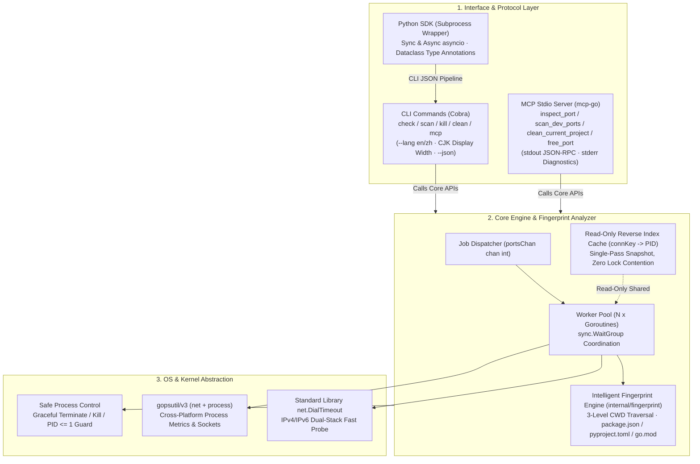

# port-detective 🕵️‍♂️

<p align="center">
  <strong>An AI-Native, cross-platform Port Inspector, Framework Fingerprint Engine & Process Diagnostic Tool designed for Claude Code, Cursor, Windsurf & Modern Developers (CLI + MCP Server + Python SDK).</strong>
</p>

> **Release status:** The repository currently tracks the v1.1 development line.
> The first `v1.1.0` release tag and published archives are still pending the
> release-readiness gates in [QUALITY_REVIEW.md](docs/project/QUALITY_REVIEW.md). Use a release
> archive when available, or build from the pinned source revision.

<p align="center">
  <a href="README_zh.md">
    
  </a>
  <a href="https://github.com/EquityQ/port-detective/actions/workflows/ci.yml">
    
  </a>
  <a href="https://goreportcard.com/report/github.com/EquityQ/port-detective">
    
  </a>
  <a href="https://opensource.org/licenses/MIT">
    
  </a>
  <a href="https://golang.org/">
    
  </a>
  <a href="https://modelcontextprotocol.io/">
    
  </a>
  <a href="python/README.md">
    
  </a>
</p>

<p align="center">
  <a href="#-the-problem--vision">The Problem</a> •
  <a href="#-10-second-ai-agent-setup-mcp">AI Integration</a> •
  <a href="#-terminal-cli-experience">CLI Usage</a> •
  <a href="#-python-sdk-quickstart">Python SDK</a> •
  <a href="#-system-architecture">Architecture</a> •
  <a href="#-cross-platform-benchmarks">Benchmarks</a> •
  <a href="#-installation">Installation</a>
</p>

## Quick start

```bash
# Install the CLI from source
go install github.com/EquityQ/port-detective@master

# Inspect, scan, and preview a safe cleanup
port-detective check 3000
port-detective scan --ports 3000,5173,8080
port-detective clean --dry-run

# Start the MCP server for an AI client
port-detective mcp
```

For the Python SDK, install the local package with `python -m pip install ./python`.
The SDK calls the CLI, so keep both components on the same reviewed version.

Documentation map: [docs/](docs/README.md) · [community](docs/community/CONTRIBUTING.md) ·
[project](docs/project/ROADMAP.md) · [operations](docs/operations/PLATFORM_SUPPORT.md) ·
[releases](docs/releases/CHANGELOG.md).

---

## 💡 The Problem & Vision

### The `EADDRINUSE` Dilemma in the AI Coding Era
Modern AI coding agents (**Claude Code**, **Cursor**, **Windsurf**, **Cline**) frequently spin up local development servers (`npm run dev`, `python app.py`, `docker compose`, `go run`). When developer sessions restart or crash, orphaned background processes silently cling to vital ports (e.g., `3000`, `5173`, `8000`, `8080`).

When this occurs:
1. **AI Blind Spots**: AI assistants typically execute fragmented shell scripts (`netstat -ano | findstr`, `lsof -i :3000`, or `kill -9 $(lsof -t)`). These commands break across operating systems (Windows vs macOS vs Linux) and suffer from fragile regex parsing.
2. **The "Blind Kill" Hazard**: Standard utilities only report raw PIDs without contextual health metrics (memory RSS, CPU utilization, command-line arguments). Asking an AI to "kill whatever is on port 8080" risks terminating critical databases, production proxies, or system daemons.
3. **Missing Project Context**: Developers and AI agents cannot easily determine *which project* or *which framework* spawned a listening port, leading to manual hunting across terminal tabs.

### The `port-detective` Antidote
- 🧠 **Intelligent Multi-Ecosystem Fingerprint Engine**: Automatically detects project identity and framework:
  - **Node.js**: Parses `package.json` to identify **Next.js**, **Vite**, **Nuxt**, **Express**, **NestJS**, etc.
  - **Python**: Correlates process command line and `pyproject.toml` / `requirements.txt` to identify **FastAPI** (Uvicorn), **Django**, **Streamlit**, **Jupyter**, **Flask**, etc.
  - **Go**: Inspects `go.mod` module paths and detects **Gin**, **Fiber**, **Echo**, **Beego**, etc.
- 🧹 **One-Click Project Port Clean (`clean`)**: Concurrently scans dev ports and terminates orphan processes belonging strictly to the current working directory, preventing accidental collateral damage.
- 🩺 **Deep Process Diagnostics**: Complete metrics on demand—PID, binary name, command-line arguments, resident memory (`MemoryMB`), CPU usage percentage, and health status (`occupied`, `free`, `permission_required`).
- 🛡️ **Safety-First & Guardrailed**: Built-in `--dry-run` simulation mode. Hard-coded protections **strictly prohibit terminating system processes (`PID <= 1`)**.
- 🔒 **Revalidated Termination**: Before a real termination, the CLI rechecks the port owner and process creation time to reduce PID reuse and race-window risks. Permission-limited processes are skipped with an explicit diagnostic.
- 🤖 **Zero-Pollution MCP Stdio Server**: Dedicated Stdio protocol server for AI agents. `os.Stdout` is 100% clean JSON-RPC, while all diagnostics flow to `os.Stderr`.
- 🌐 **Native Bilingual CLI**: Supports `--lang en` and `--lang zh` (auto-detected from system environment), with Unicode East Asian Width (CJK) table alignment.

---

## 🤖 10-Second AI Agent Setup (MCP)

`port-detective` natively provides a **Model Context Protocol (MCP)** Stdio server. Integrate it into your AI assistant in seconds:

### 1. Client Configurations

#### Cursor (`.cursor/mcp.json` or Global MCP Settings)
```json
{
  "mcpServers": {
    "port-detective": {
      "command": "port-detective",
      "args": ["mcp"]
    }
  }
}
```

#### Claude Desktop / Claude Code
```bash
claude mcp add port-detective -- port-detective mcp
```
*Or add to `claude_desktop_config.json`:*
```json
{
  "mcpServers": {
    "port-detective": {
      "command": "port-detective",
      "args": ["mcp"]
    }
  }
}
```

#### Windsurf / VS Code (Cline / Roo Code)
Add to your extensions' `mcpSettings.json`:
```json
{
  "mcpServers": {
    "port-detective": {
      "command": "port-detective",
      "args": ["mcp"]
    }
  }
}
```

### 2. The 4 Registered MCP Tools

| Tool Name | Type | Description | Key Arguments |
|:---|:---:|:---|:---|
| `inspect_port` | 🔍 Read-Only | Check if a local port is occupied and get owning process health metrics (PID, name, memory MB, CPU%, cmdline, and framework fingerprint). | `port` *(number, required, 1-65535)* |
| `scan_dev_ports` | ⚡ Read-Only | Concurrently scan multiple development ports using Go goroutines and return occupied ports with framework metadata. | `ports` *(string, optional, comma-separated e.g. "3000,8080")* |
| `clean_current_project` | 🧹 Destructive | Concurrently scan dev ports and terminate orphan processes belonging to the current working directory project (default dry-run preview). | `dry_run` *(boolean, default: true)* |
| `free_port` | 🛡️ Destructive | Terminate the process occupying a port (PID <= 1 protected). Defaults to `dry_run=true` for safe preview. | `port` *(number, required)*<br/>`dry_run` *(boolean, default: true)* |

---

## 🖥️ Terminal CLI Experience

### 1. Inspect Single Port (`check`)
```bash
port-detective check 3000
```
```text
Port Diagnostic  TCP/3000
────────────────────────────────────────────────────────────────
  Connection State
  Status     : Occupied
  Protocol   : TCP
  Summary    : occupied

  Owning Process
  Process    : node
  PID        : 45672
  Framework  : Next.js
  Project    : my-web-portal
  Path       : F:\Workspace\my-web-portal
  Command    : node server.js --port 3000
  Memory     : 142.5 MB
  CPU        : 1.8%

────────────────────────────────────────────────────────────────
  Elapsed: 4ms  ·  Release: port-detective kill 3000
```

### 2. Concurrent Dev Ports Scan (`scan`)
Scans common dev ports (`3000, 3306, 5173, 5432, 6379, 8000, 8080, 8888, 9000, 27017`) and displays detected framework fingerprints:
```bash
port-detective scan
```
Use `--ports` to scan a specific comma-separated list:
```bash
port-detective scan --ports 3000,8080,5432
```
```text
Port Scanner  TCP
────────────────────────────────────────────────────────────────────────────────

  PORT     PID  PROCESS       FRAMEWORK       PROJECT                     RSS       CPU  STATUS    
  3000   45672  node          Next.js         my-web-portal          142.5 MB      1.8%  occupied  
  8000   12344  python        FastAPI         ai-backend              85.2 MB      0.5%  occupied  

  2 port(s) occupied  ·  Engine: Concurrent (10 target ports)  ·  Elapsed: 5ms
────────────────────────────────────────────────────────────────────────────────
Details: port-detective check <port>      Release: port-detective kill <port>
```

Switch between languages with `--lang`:
```bash
port-detective scan --lang zh
```

### 3. One-Click Project Port Clean (`clean`)
Executed from your project root, `clean` terminates only orphan processes belonging to this directory:
```bash
# 1. Safe dry-run preview (default)
port-detective clean --dry-run

# 2. Terminate orphan processes
port-detective clean -y
```

### 4. Release Port (`kill`)
```bash
# Dry-run preview
port-detective kill 3000 --dry-run

# Terminate process
port-detective kill 3000 -y
```

`kill` and `clean` are designed for local development cleanup. Project cleanup matches
the detected process working directory and the current project path; processes whose
metadata cannot be read are not selected. Always review the dry-run output before using
`-y` or `--dry-run=false`, especially when running with elevated privileges.

### 5. Machine-Readable JSON Pipeline (`--json`)
The operational commands (`check`, `scan`, `kill`, and `clean`) support `--json` for direct pipelines with `jq`:
```bash
port-detective scan --json | jq '.[].project.framework'
# Output: "Next.js", "FastAPI"
```

---

## 🐍 Python SDK Quickstart

Zero-CGo **Subprocess Wrapper** architecture guarantees frictionless installation across all platforms:

```bash
# From this repository checkout
python -m pip install ./python
```

Use `python -m pip install port-detective` after the matching SDK release is published.

### Synchronous API
```python
from port_detective import inspect_port, scan_ports, clean_project, free_port

# 1. Inspect port & extract project fingerprint
diag = inspect_port(3000)
if diag.is_open:
    fw = diag.project.framework if diag.project else "Unknown"
    print(f"Port 3000 occupied by {diag.process_name} [{fw}] (PID: {diag.pid})")

# 2. Concurrently scan dev ports
occupied = scan_ports([3000, 5173, 8080])
for item in occupied:
    print(f"Port {item.port} -> PID {item.pid}")

# 3. Clean orphan processes belonging to the current project
cleaned = clean_project(dry_run=True)
print(f"Dry-run cleaned {len(cleaned)} ports")
```

### Asynchronous API (`asyncio`)
```python
import asyncio
from port_detective import async_inspect_port, async_scan_ports

async def main():
    d1, d2 = await asyncio.gather(
        async_inspect_port(3000),
        async_inspect_port(8000)
    )
    print("3000 status:", d1.status, "8000 status:", d2.status)

asyncio.run(main())
```

The Python SDK is a subprocess wrapper and does not include the Go executable. Install
the CLI from the reviewed source revision above, or download the matching archive after
the `v1.1.0` release is published. Use `PORT_DETECTIVE_BIN` or the SDK's `binary_path`
argument when the executable is not on `PATH`.

---

## 🏗️ System Architecture



---

## ⚡ Cross-Platform Benchmarks

Tested on Windows 11 AMD64, macOS Sonoma (M-Series Apple Silicon), and Ubuntu 22.04 LTS:

| Scenario | Execution Mechanism | Latency | Resource Overhead |
|:---|:---|:---:|:---:|
| Single Port Inspection (`check`) | TCP Dial + Connection Index Lookup | **2~4 ms** | Negligible (zero syscall storms) |
| Dev Ports Concurrent Scan (`scan`) | Goroutine pool scanning 10 dev ports | **3~6 ms** | < 10 MB RSS |
| Framework Fingerprint Detection | Upward traversal (3 levels) with 50ms circuit breaker | **0.5~2 ms** | Zero scanning blockage |
| Full Port Range Scan (`1-65535`) | 128 Goroutines Worker Pool | **~8.2 s** | Controlled CPU, zero leak |

---

## 📦 Installation

### Via `go install` (source revision)
```bash
go install github.com/EquityQ/port-detective@master
```

For reproducible builds, replace `master` with a reviewed commit or the published
`v1.1.0` tag once it is available.

### Precompiled Binaries
Download pre-built cross-platform binaries (Windows, Linux, macOS for `amd64` and `arm64`) from the [GitHub Releases](https://github.com/EquityQ/port-detective/releases) page.

### Build from Source
```bash
git clone https://github.com/EquityQ/port-detective.git
cd port-detective
go build -o port-detective .
```

Run test suite:
```bash
go test -v -race ./...
```

---

## 🤝 Contributing

Contributions are warmly welcomed! Please read our [Contributing Guide](docs/community/CONTRIBUTING.md) for Conventional Commits rules and local test instructions.

See the [current project status](docs/operations/STATUS.md), [quality review](docs/project/QUALITY_REVIEW.md),
and [roadmap](docs/project/ROADMAP.md) before opening an issue. Report vulnerabilities privately
using the [Security Policy](docs/community/SECURITY.md). Please also read the
[Code of Conduct](docs/community/CODE_OF_CONDUCT.md). The full bilingual documentation index is in
[docs/README.md](docs/README.md).

---

## 📄 License

This project is licensed under the [MIT License](LICENSE).
