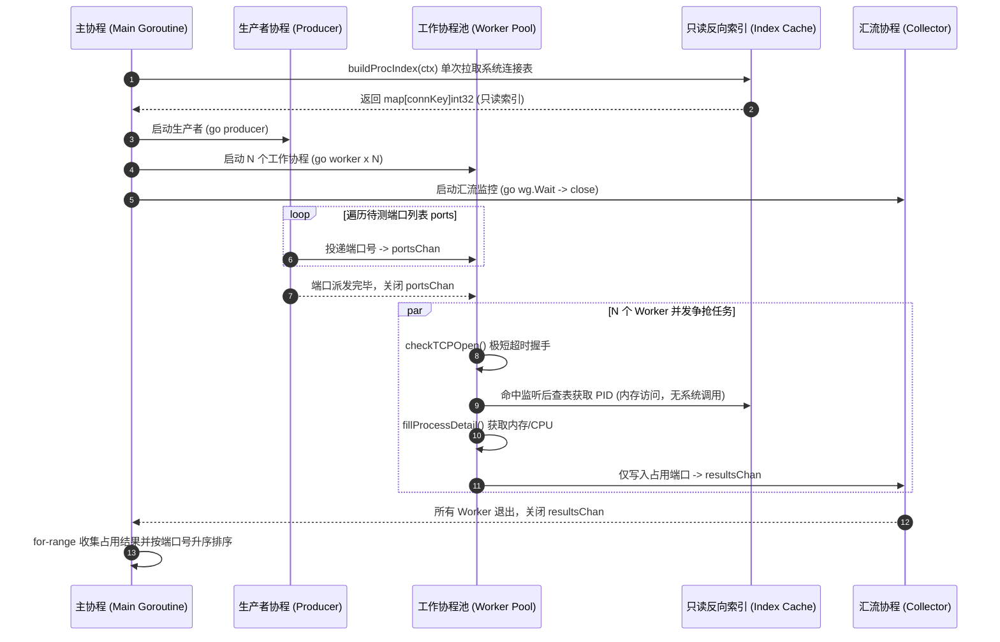

# port-detective (本地端口侦探与进程体检工具)

> 🚀 **AI-Native 跨平台本地端口体检与安全释放引擎**  
> 专为 **Claude Code / Cursor / Windsurf / AI IDE** 及开发者终端设计，原生支持 **MCP (Model Context Protocol)** 协议与高并发并发协程池。

---

## 📖 1. 项目背景与解决痛点

在现代全栈开发与微服务调试过程中，端口冲突是高频发生的问题（例如：`Error: listen EADDRINUSE: address already in use :::3000` 或 `bind: address already in use`）。

### 传统排查方式的局限与痛点：
1. **平台命令碎片化**：Windows 依赖 `netstat -ano | findstr` 再配合 `taskkill`；Linux/macOS 则依赖 `lsof -i`、`ss -tulpn` 或 `fuser`。命令参数晦涩，跨平台体验极不一致。
2. **信息单薄，缺乏体检上下文**：传统命令往往只能输出 PID，无法直观查看进程的 **物理内存 (MemoryMB) 占用、CPU 开销、启动命令行与可执行文件路径**，难以判定该进程是开发遗留的僵尸进程（如孤儿 node/python），还是重要的系统守护进程。
3. **AI 编程智能体 (Agent) 无法可靠交互**：像 Claude Code、Cursor 等 AI 编程助手若通过执行终端 Shell 脚本排查端口，不同平台命令极易因权限、输出解析正则错误而翻车，甚至可能误杀系统关键进程。

### `port-detective` 解决方案：
- **双模统一架构**：同一套底层并发探测引擎，同时驱动 **现代终端 CLI** 与 **AI-Native MCP Stdio 服务端**。
- **深度进程体检**：严格遵守冻结核心数据契约 `PortDiagnostic`，一次调用即可全景获取：端口占用状态 (`is_open`)、归属进程名 (`process_name`)、`pid`、物理内存 (`memory_mb`)、CPU 占用率 (`cpu_percent`)、启动命令 (`cmdline`) 与诊断状态 (`status`: `occupied` / `free` / `permission_required`)。
- **并发高性能扫描**：基于 Go 原生并发模型（`goroutine` + `channel` + `sync.WaitGroup` 协程池），多端口并发探测毫秒级完成。
- **安全防误杀与预演机制**：`kill` 命令与 MCP `free_port` 原生提供 `--dry-run` 预演模式；代码内置红线保护，**严禁终止 PID <= 1 的系统保护进程**。
- **跨平台鲁棒性与权限优雅降级**：100% 纯 Go 实现，无 CGO 依赖，在 Windows / Linux / macOS 下行为完全一致；针对系统受限进程提供优雅降级（`<no-access>` 标识与友好提示），绝不崩溃。
- **MCP 纯净通道保证**：严格遵守 MCP Stdio 协议规范，`os.Stdout` 保持 100% 纯净 JSON-RPC 报文，所有诊断日志严格分流至 `os.Stderr`。

---

## 🏗️ 2. 系统三层架构设计

`port-detective` 遵循清晰的分层解耦与模块化设计原则，严格杜绝循环依赖与职责泄露：

```mermaid
flowchart TD
    subgraph Layer1["1. 交互与协议接入层 (Interface & Protocol)"]
        CLI["CLI 终端命令 (Cobra)<br/>check / scan / kill / mcp<br/>(CJK 显示宽度对齐 / NO_COLOR / --json)"]
        MCP["MCP Stdio 服务端 (mcp-go)<br/>inspect_port / scan_dev_ports / free_port<br/>(stdout 纯净 JSON-RPC / stderr 诊断日志)"]
    end

    subgraph Layer2["2. 核心并发业务引擎 (Core Engine)"]
        direction TB
        DISPATCH["任务分发管道 (portsChan chan int)"]
        WORKERS["工作协程池 (N x Worker Goroutines)<br/>并发探测 / sync.WaitGroup 协同编排"]
        COLLECT["结果汇聚管道 (resultsChan chan PortDiagnostic)<br/>升序排序 / Context 优雅取消"]
        INDEX["只读反向索引缓存 (connKey -> PID)<br/>单次全量构建系统连接表，所有协程共享"]
    end

    subgraph Layer3["3. 操作系统底层抽象层 (OS & Kernel Abstraction)"]
        NET["标准库 net.DialTimeout<br/>TCP/IPv4 & IPv6 双栈连通性快速探测"]
        GOPSUTIL["gopsutil/v3 (net + process)<br/>跨平台连接表 / PID 反查 / 内存 MB / CPU% / 命令行"]
        SIGNAL["进程控制与保护机制 (Process Control)<br/>优雅终止 / PID<=1 拦截保护 / dryRun 预演"]
    end

    CLI -->|调用 InspectPort / ScanPorts / KillPort| Layer2
    MCP -->|调用 InspectPort / ScanPorts / KillPort| Layer2

    DISPATCH --> WORKERS
    WORKERS --> COLLECT
    INDEX -.->|只读共享 (无锁竞争)| WORKERS

    WORKERS --> NET
    WORKERS --> GOPSUTIL
    Layer2 --> SIGNAL
```

### 模块职责与边界说明：
- **`internal/core`**：核心能力层。负责底层端口连通性探测、进程指标采集与并发调度。**严禁依赖任何 CLI (Cobra) 或 MCP (mcp-go) 库**，保证纯粹的业务逻辑与可测性。
- **`internal/cli`**：Cobra 终端交互层。负责参数解析、彩色高亮（遵循 `NO_COLOR` 规范）、自研 CJK 双列宽终端表格对齐及 `--json` 机器可读输出。
- **`internal/mcpserver`**：Model Context Protocol 服务端实现。将 core 层能力标准化封装为 AI Tools，提供 Stdio 双向通信。
- **`main.go`**：项目唯一入口，仅负责调用 `cli.Execute()`。

---

## ⚡ 3. Go 语言并发设计亮点与协程池解析

并发扫描是本项目的核心得分点与工程亮点，集中实现在 `internal/core/detector.go` 的 `ScanPortsConcurrent` 函数中。

### 3.1 协程池与通道数据流设计



### 3.2 核心并发技术亮点解析

#### 亮点 1：单次索引构建，彻底消除 $O(N)$ 系统调用风暴
- **背景难题**：在 Windows 平台下，`gopsutil` 的 `ConnectionsPid` 并未实现（直接返回 `ErrNotImplementedError`）；若为每个扫描端口单独发起系统连接表查询，会产生数百次昂贵的内核态调用。
- **解决方案**：在启动并发扫描前，主协程单次全量拉取系统 `tcp` 连接表，在内存中构建以 `connKey{port, sockType}` 为键、`PID` 为值的反向哈希索引。该索引在并发探测期间**作为只读共享结构传递给全部工作协程**。
- **收益**：将系统调用次数从 $O(N)$ 骤降至 $O(1)$，内存访问零锁竞争（无 Mutex 锁开销），毫秒级完成批量端口扫描。

#### 亮点 2：标准 Worker Pool 模式与双重 WaitGroup 协同
- 采用 **生产者 - 消费者 - 汇聚者** 经典三阶段流水线：
  - **任务通道** `portsChan := make(chan int, workers)`：带缓冲通道，平滑派发速率。
  - **结果通道** `resultsChan := make(chan PortDiagnostic, workers)`：工作协程发现占用端口后投递至该通道。
  - **汇聚协程**：使用单独的协程等待全部 worker 执行完成（`wg.Wait()`），再安全关闭 `resultsChan` 通道，防止主协程在 `for-range` 消费时发生死锁或读取未完成数据。

#### 亮点 3：级联 Context 优雅取消与防泄漏
- 无论是任务派发还是结果投递，通道收发均配合 `select` 监听 `ctx.Done()`：
  ```go
  select {
  case <-ctx.Done():
      return // 上游取消时迅速收工，释放协程资源
  case portsChan <- port:
  }
  ```
- 当用户在终端发起 `Ctrl+C` 或上层超时发生时，所有后台 Worker 会立即终止未完成的探测任务，避免无谓的 CPU 与网络套接字占用。

#### 亮点 4：结果排序与幂等确定性
- 并发协程完成任务的顺序是不确定的。`core` 层在收集完所有活跃端口后，强制通过 `sort.Slice` 进行升序重排，确保 CLI 渲染、单测断言和 AI 工具调用的结果具备 100% 的幂等性与确定性。

---

## 📦 4. 冻结核心契约与接口规范

`internal/core` 对外提供以下完全冻结的数据契约与接口方法：

```go
package core

// PortDiagnostic 单个端口与所属进程的体检报告
type PortDiagnostic struct {
	Port        int     `json:"port"`
	IsOpen      bool    `json:"is_open"`
	Protocol    string  `json:"protocol"`     // "tcp"
	PID         int32   `json:"pid"`          // 占用进程 PID（未查到则为 0）
	ProcessName string  `json:"process_name"` // 进程名称，如 "node", "python", "go"
	Cmdline     string  `json:"cmdline"`      // 启动命令行参数
	MemoryMB    float64 `json:"memory_mb"`    // 进程物理内存占用 (MB)
	CPUPercent  float64 `json:"cpu_percent"`  // 进程 CPU 占用率 (%)
	Status      string  `json:"status"`       // "occupied", "free", "permission_required"
}

// DefaultDevPorts 默认高频开发端口列表（恰好 10 个标准端口）
var DefaultDevPorts = []int{3000, 3306, 5173, 5432, 6379, 8000, 8080, 8888, 9000, 27017}

// 1. 侦探单端口
func InspectPort(ctx context.Context, port int) (*PortDiagnostic, error)

// 2. 并发扫描多端口（核心得分点）
func ScanPortsConcurrent(ctx context.Context, ports []int) ([]PortDiagnostic, error)

// 3. 释放端口（支持 dryRun 预演与系统保护进程防护）
func KillPortProcess(ctx context.Context, port int, dryRun bool) (*PortDiagnostic, string, error)
```

---

## 🖥️ 5. 终端 CLI 使用指南与真实运行效果

### 5.1 CLI 命令一览

```text
port-detective
├── check <端口>    [--json]                              体检指定单端口
├── scan            [--ports 3000,8080,5432] [--json]     并发扫描开发端口
├── kill  <端口>    [--dry-run] [-y|--yes] [--json]       安全释放占用端口
└── mcp             [--json]                              启动 MCP Stdio 服务端
```

### 5.2 命令运行实测示例

#### ① 单端口详细体检 (`check`)
查询指定端口的监听状态及占用进程全景指标：
```bash
port-detective check 19387
```
**终端真实输出：**
```text
端口体检  TCP/19387
──────────────────────────────────────────────────────────
  连接状态
  状态       : 已占用
  协议       : TCP
  诊断摘要   : occupied

  归属进程
  进程名     : DeepSeek Harness.exe
  PID        : 97192
  常驻内存   : 212.7 MB
  CPU 占用   : 1.9%

──────────────────────────────────────────────────────────
  探测耗时 5ms  ·  释放命令  port-detective kill 19387
```

检查空闲端口：
```bash
port-detective check 8080
```
```text
端口体检  TCP/8080
──────────────────────────────────────────────────────────
  连接状态
  状态       : 空闲
  协议       : TCP
  诊断摘要   : free
  结论       : 该端口当前无人监听，可以直接使用。
──────────────────────────────────────────────────────────
  探测耗时 4ms
```

#### ② 端口并发扫描 (`scan`)
- 默认并发扫描 `DefaultDevPorts`（10 个高频开发端口）：
```bash
port-detective scan
```
**终端真实输出：**
```text
端口扫描  TCP
────────────────────────────────────────────────────────────────

  PORT    PID   PROCESS       RSS   CPU   STATUS             
  5432   9784   <no-access>     -     -   permission_required
  6379   7452   <no-access>     -     -   permission_required

  共 2 个端口被占用  ·  引擎 并发扫描 (10 个目标端口)  ·  耗时 6ms
  ! 其中 2 个端口的归属进程属系统保护进程，当前权限无法读取详情。
    以管理员（Windows）或 root（Linux/macOS）身份运行可查看完整信息。
────────────────────────────────────────────────────────────────
查看详情  port-detective check <端口>      释放端口  port-detective kill <端口>
```

- 自定义端口列表扫描：
```bash
port-detective scan --ports 3000,8080,19387
```

#### ③ 安全释放端口 (`kill`)
支持 `--dry-run` 安全预演模式，避免误杀：
```bash
# 安全预演（不真正杀进程）
port-detective kill 19387 --dry-run
```
**输出：**
```text
释放端口  19387 (预演模式)
──────────────────────────────────────────────────────────

  目标进程信息
  进程名   : DeepSeek Harness.exe
  PID      : 97192
  物理内存 : 212.7 MB

  预演 预演成功：将终止占用端口 19387 的进程 "DeepSeek Harness.exe" (PID: 97192)，当前物理内存占用 212.7 MB
```

真实终止进程（带交互确认）：
```bash
port-detective kill 3000
# 或跳过交互确认：
port-detective kill 3000 -y
```

#### ④ 结构化 JSON 模式 (`--json`)
所有命令均支持 `--json` 输出纯净 JSON，方便脚本或 CI 消费：
```bash
port-detective check 19387 --json
```
```json
{
  "port": 19387,
  "is_open": true,
  "protocol": "tcp",
  "pid": 97192,
  "process_name": "DeepSeek Harness.exe",
  "cmdline": "",
  "memory_mb": 212.71,
  "cpu_percent": 1.89,
  "status": "occupied"
}
```

---

## 🤖 6. AI Agent (MCP) 接入配置指南

本项目已完全实现 **Model Context Protocol (MCP)** 标准，通过 Stdio 协议与 AI 宿主无缝集成。

### 6.1 MCP 工具集规范 (Tools)

| 工具名称 (`Tool Name`) | 属性 (`Attributes`) | 功能描述 (`Description`) | 参数规范 |
| :--- | :--- | :--- | :--- |
| `inspect_port` | `ReadOnly: true`<br/>`Destructive: false` | Check if a local port is occupied and get the owning process health metrics (PID, name, memory MB, CPU%, command line). | `port` (number, 必填, 1-65535) |
| `scan_dev_ports` | `ReadOnly: true`<br/>`Destructive: false` | Concurrently scan multiple development ports using Go goroutines and return all occupied ports with process diagnostics. | `ports` (string, 选填, 逗号分隔如 "3000,8080"，留空扫描 DefaultDevPorts) |
| `free_port` | `ReadOnly: false`<br/>`Destructive: true` | Terminate the local process occupying the specified port. Set dry_run=false to actually kill the process. | `port` (number, 必填)<br/>`dry_run` (boolean, 选填, 默认 true) |

### 6.2 客户端配置示例

#### A. Claude Code 配置
```bash
claude mcp add port-detective -- /absolute/path/to/port-detective mcp
```

#### B. Cursor 配置 (`.cursor/mcp.json`)
```json
{
  "mcpServers": {
    "port-detective": {
      "command": "F:/AI Workspace/port-detective/port-detective.exe",
      "args": ["mcp"]
    }
  }
}
```

#### C. Windsurf / VS Code (Cline / Roo Code) 配置
```json
{
  "mcpServers": {
    "port-detective": {
      "command": "port-detective",
      "args": ["mcp"]
    }
  }
}
```

### 6.3 MCP Stdout 零污染技术保证
- **架构级流隔离**：服务端启动提示与所有非致命诊断信息全部重定向至 `os.Stderr`。
- **纯净性自动化断言**：运行 `python scripts/mcp/verify_stdout_purity.py` 自动化断言标准输出为纯净合法的单行 JSON-RPC 报文，0 字符 ANSI 转义。

---

## 🛠️ 7. 编译构建与测试验证

```bash
# 1. 编译可执行文件
go build -o port-detective .

# 2. 运行全套单元测试（42 个用例全部 PASS）
go test -v ./...

# 3. 运行竞态检查（Race Detector）
go test -race ./...

# 4. 运行 MCP 协议端到端验证脚本
python scripts/mcp/verify_handshake.py
python scripts/mcp/verify_stdout_purity.py
python scripts/mcp/verify_tools.py
```

---

## 📄 License
本项目使用 MIT 许可证开源。
