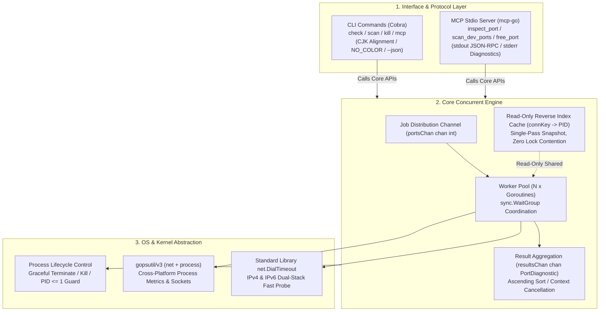

# port-detective 🕵️‍♂️

<p align="center">
  <strong>An AI-Native, cross-platform Port & Process Inspector designed for Claude Code, Cursor, Windsurf & Developers (CLI + MCP Server).</strong>
</p>

<p align="center">
  <a href="https://github.com/EquityQ/port-detective/actions/workflows/ci.yml">
    
  </a>
  <a href="https://goreportcard.com/report/github.com/EquityQ/port-detective">
    
  </a>
  <a href="https://opensource.org/licenses/MIT">
    
  </a>
  <a href="https://golang.org/">
    
  </a>
  <a href="https://modelcontextprotocol.io/">
    
  </a>
</p>

<p align="center">
  <a href="#-the-problem--vision">The Problem</a> •
  <a href="#-10-second-ai-agent-setup-mcp">AI Integration</a> •
  <a href="#-terminal-cli-experience">CLI Usage</a> •
  <a href="#-system-architecture">Architecture</a> •
  <a href="#-spec-driven-ai-development">Spec-Driven</a> •
  <a href="#-installation">Installation</a>
</p>

---

## 💡 The Problem & Vision

### The `EADDRINUSE` Dilemma in the AI Coding Era
Modern AI coding agents (**Claude Code**, **Cursor**, **Windsurf**, **Cline**) frequently spin up local development servers (`npm run dev`, `python app.py`, `docker compose`, `go run`). When developer sessions restart or crash, orphaned background processes silently cling to vital ports (e.g., `3000`, `8080`, `5432`).

When this occurs:
1. **AI Blind Spots**: AI assistants typically run naive shell scripts (`netstat -ano | findstr`, `lsof -i :3000`, or `kill -9 $(lsof -t)`). These commands are notoriously fragmented across platforms (Windows vs macOS vs Linux) and prone to syntax breaks or regex parsing errors.
2. **The "Blind Kill" Hazard**: Standard tools only report PIDs without contextual health metrics (memory RSS, CPU utilization, command-line arguments). Asking an AI to "kill whatever is on port 8080" risks terminating critical databases, production proxies, or system daemons.
3. **Permission Wall**: On Windows or Linux, protected system services (like `svchost.exe` or root services) cause abrupt crashes or permission-denied errors that break automated AI agent workflows.

### The `port-detective` Antidote
- 🩺 **Deep Process Diagnostics**: Provides complete process diagnostics—PID, binary name, command-line invocation, resident memory (`MemoryMB`), CPU usage percentage, and health status (`occupied`, `free`, `permission_required`).
- 🛡️ **Safety-First & Guardrailed**: Built-in `--dry-run` simulation mode. Hard-coded kernel protections **strictly prohibit terminating system processes (`PID <= 1`)**.
- ⚡ **High-Concurrency Worker Pool**: Pure Go concurrent scanning engine (`goroutine` + `channel` + `sync.WaitGroup`) checking common dev ports in milliseconds.
- 🤖 **Zero-Pollution MCP Stdio Server**: Seamless native integration with AI agents via the official Model Context Protocol (MCP). `os.Stdout` is 100% clean JSON-RPC, while all diagnostics flow to `os.Stderr`.

---

## 🤖 10-Second AI Agent Setup (MCP)

`port-detective` speaks **Model Context Protocol (MCP)** natively via Stdio. Plug it into your AI assistant in seconds:

### 1. Client Configurations

#### Cursor (`.cursor/mcp.json` or Global MCP Settings)
```json
{
  "mcpServers": {
    "port-detective": {
      "command": "port-detective",
      "args": ["mcp"]
    }
  }
}
```

#### Claude Desktop / Claude Code
```bash
claude mcp add port-detective -- port-detective mcp
```
*Or add to `claude_desktop_config.json`:*
```json
{
  "mcpServers": {
    "port-detective": {
      "command": "port-detective",
      "args": ["mcp"]
    }
  }
}
```

#### Windsurf / VS Code (Cline / Roo Code)
Add to your extensions' `mcpSettings.json`:
```json
{
  "mcpServers": {
    "port-detective": {
      "command": "port-detective",
      "args": ["mcp"]
    }
  }
}
```

### 2. Available MCP Tools

| Tool Name | Type | Description | Key Arguments |
|:---|:---:|:---|:---|
| `inspect_port` | 🔍 Read-Only | Check if a local port is occupied and get owning process health metrics (PID, name, memory MB, CPU%, cmdline). | `port` *(number, required, 1-65535)* |
| `scan_dev_ports` | ⚡ Read-Only | Concurrently scan multiple development ports using Go goroutines and return occupied ports. | `ports` *(string, optional, comma-separated e.g. "3000,8080")* |
| `free_port` | 🛡️ Destructive | Terminate the process occupying a port. Defaults to `dry_run=true` for safe preview. | `port` *(number, required)*<br/>`dry_run` *(boolean, default: true)* |

---

## 🖥️ Terminal CLI Experience

Prefer working directly in your terminal? `port-detective` offers a refined, human-centric CLI featuring auto-detected Unicode CJK width alignment, `NO_COLOR` adherence, and script-friendly `--json` output.

### 1. Inspect Single Port (`check`)
```bash
port-detective check 19387
```
```text
端口体检  TCP/19387
──────────────────────────────────────────────────────────
  连接状态
  状态       : 已占用
  协议       : TCP
  诊断摘要   : occupied

  归属进程
  进程名     : DeepSeek Harness.exe
  PID        : 97192
  常驻内存   : 212.7 MB
  CPU 占用   : 1.9%

──────────────────────────────────────────────────────────
  探测耗时 5ms  ·  释放命令  port-detective kill 19387
```

### 2. Concurrent Dev Ports Scan (`scan`)
Concurrently scans common development ports (`3000, 3306, 5173, 5432, 6379, 8000, 8080, 8888, 9000, 27017`):
```bash
port-detective scan
```
```text
端口扫描  TCP
────────────────────────────────────────────────────────────────

  PORT    PID   PROCESS       RSS   CPU   STATUS             
  5432   9784   <no-access>     -     -   permission_required
  6379   7452   <no-access>     -     -   permission_required

  共 2 个端口被占用  ·  引擎 并发扫描 (10 个目标端口)  ·  耗时 6ms
  ! 其中 2 个端口的归属进程属系统保护进程，当前权限无法读取详情。
    以管理员（Windows）或 root（Linux/macOS）身份运行可查看完整信息。
────────────────────────────────────────────────────────────────
查看详情  port-detective check <端口>      释放端口  port-detective kill <端口>
```

Scan custom port targets:
```bash
port-detective scan --ports 3000,8080,19387
```

### 3. Safe Process Release (`kill`)
Preview process termination with `--dry-run` to prevent accidental disruption:
```bash
port-detective kill 19387 --dry-run
```
```text
释放端口  19387 (预演模式)
──────────────────────────────────────────────────────────

  目标进程信息
  进程名   : DeepSeek Harness.exe
  PID      : 97192
  物理内存 : 212.7 MB

  预演 预演成功：将终止占用端口 19387 的进程 "DeepSeek Harness.exe" (PID: 97192)，当前物理内存占用 212.7 MB
```

Execute graceful termination with interactive confirmation (or `-y` to skip):
```bash
port-detective kill 3000 -y
```

### 4. Machine-Readable JSON Pipeline (`--json`)
All subcommands support `--json` for seamless scripting and pipe workflows with `jq`:
```bash
port-detective check 19387 --json | jq .memory_mb
# Output: 212.71
```

---

## 🏗️ System Architecture

`port-detective` follows a strict three-layer decoupled architecture:



### Concurrency Highlights
- **O(1) Snapshot Indexing**: Instead of triggering expensive OS kernel system calls for each port, `port-detective` captures the connection table in a single pass into a read-only index shared across all worker goroutines.
- **Worker Pool with Graceful Cancellation**: Workers listen to `ctx.Done()`, ensuring zero goroutine leakage when cancelled by timeout or user `Ctrl+C`.

---

## 🎯 Spec-Driven AI Development

`port-detective` is an exemplar project engineered using the **Spec-Driven Multi-Agent Development (SDD)** paradigm:

- **Strict Contracts**: All data schemas (`PortDiagnostic`) and function signatures are frozen in [`AGENTS.md`](./AGENTS.md).
- **Zero-Hallucination Relay**: Step-by-step progress and inter-agent handoff logs are tracked deterministically in [`PROGRESS.md`](./PROGRESS.md).
- **100% Test Coverage & Clean CI**: 42 unit test cases covering dynamic loopback listeners, race condition audits (`-race`), and Stdio purity verification.

---

## 📦 Installation

### Via `go install`
```bash
go install github.com/EquityQ/port-detective@latest
```

### Precompiled Binaries
Download pre-built cross-platform binaries (Windows, Linux, macOS for `amd64` and `arm64`) from the [GitHub Releases](https://github.com/EquityQ/port-detective/releases) page.

### Build from Source
```bash
git clone https://github.com/EquityQ/port-detective.git
cd port-detective
go build -o port-detective .
```

---

## 🤝 Contributing

Contributions are warmly welcomed! Please read our [Contributing Guide](CONTRIBUTING.md) for Conventional Commits rules and local test instructions.

---

## 📄 License

This project is licensed under the [MIT License](LICENSE).
