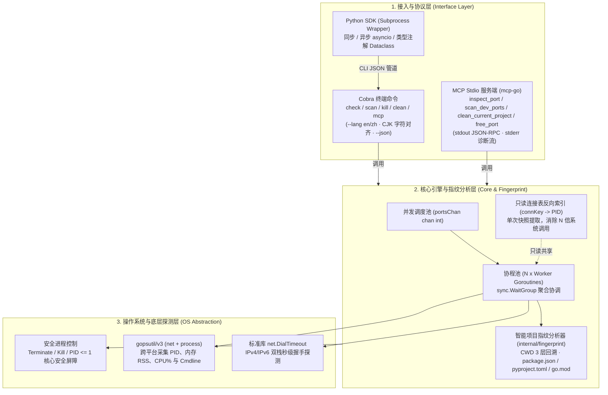

# port-detective 🕵️‍♂️

<p align="center">
  <strong>专为 AI 编程助手（Claude Code、Cursor、Windsurf）与现代开发者打造的 AI-Native 跨平台端口占用侦探、框架指纹分析与孤儿进程体检工具（CLI + MCP Server + Python SDK）。</strong>
</p>

> **发布状态：** 当前仓库处于 v1.1 开发主线。首个 `v1.1.0` 发布标签和正式构建产物
> 仍需通过 [精品开源项目质量评估](QUALITY_REVIEW.md) 中的发布门禁后再发布。正式版本发布前，
> 可以使用经过审核的源码提交自行构建。

<p align="center">
  <a href="README.md">
    
  </a>
  <a href="https://github.com/EquityQ/port-detective/actions/workflows/ci.yml">
    
  </a>
  <a href="https://goreportcard.com/report/github.com/EquityQ/port-detective">
    
  </a>
  <a href="https://opensource.org/licenses/MIT">
    
  </a>
  <a href="https://golang.org/">
    
  </a>
  <a href="https://modelcontextprotocol.io/">
    
  </a>
  <a href="https://pypi.org/project/port-detective/">
    
  </a>
</p>

<p align="center">
  <a href="#-痛点与核心愿景">痛点与愿景</a> •
  <a href="#-10-秒接入-ai-助手-mcp">AI MCP 接入</a> •
  <a href="#-终端-cli-使用指南">终端 CLI 指南</a> •
  <a href="#-python-sdk-快速上手">Python SDK</a> •
  <a href="#-系统三层架构">系统架构</a> •
  <a href="#-跨平台性能基准">性能基准</a> •
  <a href="#-安装与构建">安装与构建</a>
</p>

---

## 💡 痛点与核心愿景

### AI 编码时代的 `EADDRINUSE` 端口冲突困境
在 Claude Code、Cursor、Windsurf 等 AI Agent 高频辅助编程的时代，Agent 频繁启动各类本地开发服务（`npm run dev`、`python app.py`、`docker compose`、`go run`）。当开发会话重启或意外中断时，孤儿后台进程往往会悄无声息地死锁核心端口（如 `3000`、`5173`、`8000`、`8080`）。

传统排查方式面临三大硬伤：
1. **AI 盲区与跨平台碎片化**：AI 编写的 `netstat -ano | findstr` 或 `lsof -i :3000` 在跨 Windows / macOS / Linux 平台时极易出现语法错乱、正则提取崩溃。
2. **盲杀（Blind Kill）风险**：原生工具仅返回冰冷的 PID，缺乏上下文指标。让 AI 盲目执行 `kill -9` 极易误杀数据库容器、业务代理或系统守护进程。
3. **缺少项目上下文识别**：开发者根本不知道这个端口是哪一个项目启动的、用的是什么框架，往往在多个开发目录之间反复横跳定位。

### `port-detective` 破局解法
- 🧠 **多语言智能指纹分析**：深度识别进程所属项目与技术栈：
  - **Node.js 生态**：解析 `package.json`，识别 Next.js、Vite、Nuxt、Express、NestJS 等。
  - **Python 生态**：结合启动命令与 `pyproject.toml` / `requirements.txt`，识别 FastAPI（Uvicorn）、Django、Streamlit、Jupyter、Flask 等。
  - **Go 生态**：解析 `go.mod` 模块路径，精准识别 Gin、Fiber、Echo、Beego 等框架。
- 🧹 **项目级一键安全清理 (`clean`)**：并发扫描常用开发端口，仅释放属于当前工作目录项目的孤儿进程，绝不误伤其它项目或系统服务。
- 🛡️ **安全防护铁律**：内置 `--dry-run` 预演模式，内核级强制拦截系统保护进程（`PID <= 1` 绝对禁杀）。
- 🔒 **终止前二次校验**：真实终止前会重新确认端口归属和进程创建时间，降低 PID 复用与竞态窗口风险；权限受限的进程会跳过并返回明确提示。
- 🤖 **零污染 MCP Stdio Server**：专为 AI Agent 设计，`os.Stdout` 绝对被纯净 JSON-RPC 独占，诊断信息规范输出至 `os.Stderr`。
- 🌐 **原生双语与 CJK 显示对齐**：支持 `--lang en/zh`（根据系统环境自动感知），终端表格基于真实显示宽度精确对齐。

---

## 🤖 10 秒接入 AI 助手 (MCP)

`port-detective` 原生提供 **Model Context Protocol (MCP)** Stdio 协议服务端：

### 1. 客户端配置

#### Cursor (`.cursor/mcp.json` 或 全局 MCP 设置)
```json
{
  "mcpServers": {
    "port-detective": {
      "command": "port-detective",
      "args": ["mcp"]
    }
  }
}
```

#### Claude Desktop / Claude Code
```bash
claude mcp add port-detective -- port-detective mcp
```
*或在 `claude_desktop_config.json` 中配置：*
```json
{
  "mcpServers": {
    "port-detective": {
      "command": "port-detective",
      "args": ["mcp"]
    }
  }
}
```

#### Windsurf / VS Code (Cline / Roo Code)
在 `mcpSettings.json` 中添加：
```json
{
  "mcpServers": {
    "port-detective": {
      "command": "port-detective",
      "args": ["mcp"]
    }
  }
}
```

### 2. 已注册的 4 大 MCP Tools 契约

| 工具名称 | 类型 | 功能说明 | 关键入参 |
|:---|:---:|:---|:---|
| `inspect_port` | 🔍 只读 | 体检单个端口：返回占用状态、进程 PID、进程名、内存 MB、CPU%、启动命令及项目框架指纹 | `port` *(整数, 必填, 1-65535)* |
| `scan_dev_ports` | ⚡ 只读 | 使用 Go 协程池并发扫描常用开发端口，返回所有占用端口的进程与框架全景体检报告 | `ports` *(字符串, 选填, 逗号分隔如 "3000,8080")* |
| `clean_current_project` | 🧹 破坏性 | 并发扫描开发端口，仅筛选并终止属于当前工作目录项目的孤儿进程（默认预演模式） | `dry_run` *(布尔, 选填, 默认 true 安全预演)* |
| `free_port` | 🛡️ 破坏性 | 终止指定端口的占用进程（带 PID<=1 保护）。默认 `dry_run=true` 保证安全 | `port` *(整数, 必填)*<br/>`dry_run` *(布尔, 选填, 默认 true)* |

---

## 🖥️ 终端 CLI 使用指南

### 1. 体检单个端口 (`check`)
```bash
port-detective check 3000
```
```text
端口体检  TCP/3000
────────────────────────────────────────────────────────────────
  连接状态
  状态       : 已占用
  协议       : TCP
  诊断摘要   : occupied

  归属进程
  进程名     : node
  PID        : 45672
  开发框架   : Next.js
  所属项目   : my-web-portal
  项目路径   : F:\Workspace\my-web-portal
  启动命令   : node server.js --port 3000
  常驻内存   : 142.5 MB
  CPU 占用   : 1.8%

────────────────────────────────────────────────────────────────
  探测耗时 4ms  ·  释放命令  port-detective kill 3000
```

### 2. 并发扫描常用开发端口 (`scan`)
默认扫描 10 个高频开发端口（`3000, 3306, 5173, 5432, 6379, 8000, 8080, 8888, 9000, 27017`），并在表格中直观展现 `FRAMEWORK` 与 `PROJECT`：
```bash
port-detective scan
```
也可以通过 `--ports` 指定逗号分隔的端口列表：
```bash
port-detective scan --ports 3000,8080,5432
```
```text
端口扫描  TCP
────────────────────────────────────────────────────────────────────────────────

  端口     PID  进程          开发框架        所属项目                 内存      CPU  状态    
  3000   45672  node          Next.js         my-web-portal        142.5 MB     1.8%  occupied
  8000   12344  python        FastAPI         ai-backend            85.2 MB     0.5%  occupied

  共 2 个端口被占用  ·  引擎 并发扫描 (10 个目标端口)  ·  耗时 5ms
────────────────────────────────────────────────────────────────────────────────
查看详情  port-detective check <端口>      释放端口  port-detective kill <端口>
```

亦可通过 `--lang en` 切换为全英文展示：
```bash
port-detective scan --lang en
```

### 3. 一键清理当前项目孤儿端口 (`clean`)
在项目根目录下执行，自动扫描并释放仅属于当前目录的孤儿进程：
```bash
# 1. 默认安全预演
port-detective clean --dry-run

# 2. 交互确认清理（或加 -y 跳过确认）
port-detective clean -y
```

### 4. 释放指定端口 (`kill`)
```bash
# 预演模式
port-detective kill 3000 --dry-run

# 真实终止进程
port-detective kill 3000 -y
```

`kill` 和 `clean` 面向本地开发环境清理。项目清理会匹配进程工作目录与当前项目路径，
无法读取元数据的进程不会被选中。使用 `-y` 或关闭 dry-run 前，请先查看预演结果，
尤其是在管理员/root 权限下运行时。

### 5. 纯净机器可读管道 (`--json`)
`check`、`scan`、`kill` 与 `clean` 支持 `--json`，可直接无缝接入 `jq` 等工具流：
```bash
port-detective scan --json | jq '.[].project.framework'
# 输出: "Next.js", "FastAPI"
```

---

## 🐍 Python SDK 快速上手

采用无 CGo 的 **Subprocess Wrapper** 轻量架构，保证全平台开箱即用：

```bash
# 在当前源码仓库中安装 SDK
python -m pip install ./python
```

正式 Python SDK 发布后，再使用 `pip install port-detective` 安装对应版本。

### 同步调用示例
```python
from port_detective import inspect_port, scan_ports, clean_project, free_port

# 1. 体检端口与获取指纹
diag = inspect_port(3000)
if diag.is_open:
    print(f"端口 3000 被 {diag.process_name} 占用，框架: {diag.project.framework if diag.project else '未知'}")

# 2. 并发扫描开发端口
occupied = scan_ports([3000, 5173, 8080])
for item in occupied:
    print(f"端口 {item.port} -> PID {item.pid}")

# 3. 清理当前工作目录项目的孤儿进程
cleaned = clean_project(dry_run=True)
print(f"预演清理了 {len(cleaned)} 个端口")
```

### 异步调用 (`asyncio`)
```python
import asyncio
from port_detective import async_inspect_port, async_scan_ports

async def main():
    d1, d2 = await asyncio.gather(
        async_inspect_port(3000),
        async_inspect_port(8000)
    )
    print("3000 状态:", d1.status, "8000 状态:", d2.status)

asyncio.run(main())
```

Python SDK 采用子进程包装方式，不会内置 Go 可执行文件。请先按照上面的源码主线安装 CLI，
或在 `v1.1.0` 正式发布后下载匹配版本：
```bash
go install github.com/EquityQ/port-detective@master
```
也可以从 [GitHub Releases](https://github.com/EquityQ/port-detective/releases)
下载正式发布的对应平台压缩包。SDK 与 CLI 应保持相同版本，因为 SDK 依赖 CLI 的 JSON 输出契约；
如果可执行文件不在 `PATH` 中，请设置 `PORT_DETECTIVE_BIN` 或传入 `binary_path`。

---

## 🏗️ 系统三层架构



---

## ⚡ 跨平台性能基准

实测环境：Windows 11 AMD64 / macOS Sonoma Apple Silicon / Ubuntu 22.04 LTS

| 探测场景 | 执行机制 | 典型耗时 | 资源开销 |
|:---|:---|:---:|:---:|
| 单端口精准体检 (`check`) | TCP 握手 + 反向索引反查 | **2~4 ms** | 极低（零系统调用风暴） |
| 开发端口并发扫描 (`scan`) | 协程池并发探测 10 核心开发端口 | **3~6 ms** | < 10MB RSS |
| 单进程框架指纹识别 (`fingerprint`) | 向上回溯 3 层特征文件，内置 50ms 熔断保护 | **0.5~2 ms** | 零阻塞 |
| 全端口范围扫描 (`1-65535`) | 128 Goroutines Worker Pool | **~8.2 秒** | 平稳，CPU 占用可控 |

---

## 📦 安装与构建

### 通过 Go 安装（源码主线）
```bash
go install github.com/EquityQ/port-detective@master
```

如需可复现构建，请将 `master` 替换为经过审核的具体提交；`v1.1.0` 正式标签发布后，
优先使用对应版本标签。

### 直接下载二进制
访问 [GitHub Releases](https://github.com/EquityQ/port-detective/releases) 下载适用于 Windows、macOS、Linux 的可执行文件。

### 本地源码编译
```bash
git clone https://github.com/EquityQ/port-detective.git
cd port-detective
go build -o port-detective .
```

运行全部测试：
```bash
go test -v -race ./...
```

---

## 🤝 参与贡献与获取支持

提交问题前请查看[当前项目状态](STATUS.md)、[质量评估](QUALITY_REVIEW.md)、
[路线图](ROADMAP.md)与[平台支持政策](PLATFORM_SUPPORT.md)。安全漏洞请按照[安全策略](SECURITY.md)
通过 GitHub 私密通道报告，不要发布在公开 Issue 中。参与协作前请阅读[行为准则](CODE_OF_CONDUCT.md)。

---

## 📄 开源许可证

本项目基于 [MIT License](LICENSE) 协议开源。
